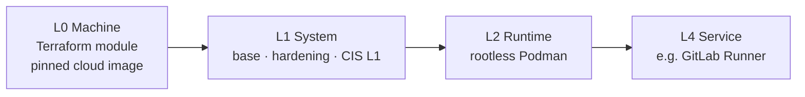

# Subterranea — security-first homelab platform as code


A self-built platform run like a small production environment: machines are
declared in **Terraform**, configured by **Ansible**, changed only through
**merge requests with CI**, and hardened to **CIS Level 1** by default.

The full project (inventory, runbooks, operations, Vault) lives in a
**self-hosted GitLab**. This repository is a **curated public skeleton** of it:
the reusable code and the ideas, without the environment — see
[How this repository is produced](#how-this-repository-is-produced).

## The idea: building blocks

Every machine is assembled from the same small, tested pieces, stacked in fixed
layers. A new service is a new combination of existing blocks plus a few lines
of data — not a new project.



Concept, contracts and security model:
[docs/platform/building-blocks.md](docs/platform/building-blocks.md).

## What is built

| Component | Highlights |
|---|---|
| **VM building block** (Terraform) | Generic Proxmox module; templates built from a pinned, checksum-verified cloud image through the API (no hypervisor SSH); state in GitLab with locking; least-privilege API token |
| **System baseline** (Ansible) | `base` (time, security updates, guest agent) → `hardening` (SELinux, sysctl, audit rules, key-only SSH, sudo with password, firewalld with anti-lockout) → `cis` (CIS L1 via ansible-lockdown, applied automatically) |
| **CI runner block** | Isolated VLAN, default-deny egress (GitLab-only entrypoint + HTTPS); runner as unprivileged user; jobs in **rootless Podman**, `privileged = false`, image allowlist; signed, version-locked packages |
| **Secrets & PKI** (private part) | Air-gapped HashiCorp Vault HA cluster (Raft, TLS 1.3, MFA), offline root CA on hardware keys — documented in the private repository |

### Security by construction

- Nothing secret in git; credentials only in memory or Vault; gitleaks in CI.
- Every change: MR → lint (yamllint, ansible-lint *production*, shellcheck,
  checkov) + secret detection + IaC SAST → merge → applied by an operator.
- CI never gets infrastructure credentials: it runs untrusted code in its own
  network zone.
- Machines are cattle: rebuilt from code, never repaired by hand.

## Status

Same phases as on the blog; a phase closes only after a penetration test.

| Phase | In this repository | Status |
|---|---|---|
| 1 · Network foundation | — (firewall and hypervisor are still hand-built; their hardening as code is next) | 🔄 segmentation, IDS/IPS, overlay access running |
| 2 · Management plane | VM module + templates · `base` → `hardening` → `cis` (L1) · CI runner block, green pipelines | 🔄 CI runner ✅ · Vault cluster ✅ (private) · backups, monitoring, CI egress allowlist in progress |
| 3 · Kubernetes | — | 📋 planned (supply chain: SBOM, signing, policy as code, GitOps) |
| 4 · AI and automation | — | 📋 planned |

Next for the platform itself: a deploy runner with short-lived credentials
(OIDC → Vault), separate from the CI runner.

## Repository layout

```
terraform/   modules/proxmox-vm (generic VM) · proxmox/ (templates + VMs)
ansible/     roles/  base · hardening · cis · podman_rootless · gitlab_runner
             playbooks/  single blocks and their compositions (ci-runner)
ci/          lint.sh — the only definition of "lint", used by GitLab and GitHub
docs/        platform/building-blocks.md — concept
tools/       how this public skeleton is produced
```

## How this repository is produced

[`tools/public-export.sh`](tools/public-export.sh) copies only allowlisted files
([`tools/public-include.txt`](tools/public-include.txt)) from the committed
private tree, replaces addresses and names with documentation values, and aborts
if anything identifying or secret remains (mapped values, private ranges,
e-mail addresses, gitleaks). No history is published.

Publication is a pipeline, not a person: the self-hosted GitLab is the only
write path to this repository. After a merge to `main`, a CI job builds the
export and shows the exact public diff; a second, manual job
([`ci/publish-github.sh`](ci/publish-github.sh)) pushes it with a deploy key
that can write to this one repository and nothing else.
