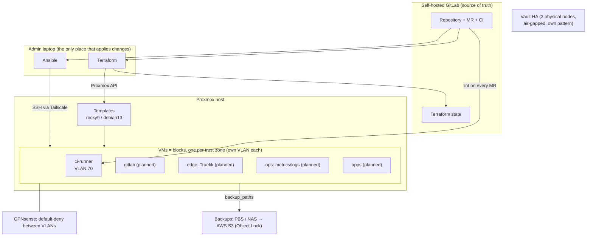

# Building blocks — how the platform is put together

This document explains the idea behind the platform: every machine is built
from the same small set of **building blocks**, stacked in fixed layers. A new
service is not a new project; it is a new combination of existing blocks plus
a few lines of data.

## 1. Why blocks

The platform runs on **one Proxmox host** and is operated by **one person**.
That shapes every decision:

| Constraint | Consequence |
|---|---|
| One host = one failure domain | No clustering for availability. Resilience comes from **rebuilding fast** and **backups**, not from redundancy. |
| One operator | Few, generic pieces. Every extra role is code that must be patched, tested and understood a year from now. |
| Security first | Every machine gets the same hardening, the same benchmark (CIS L1) and the same network isolation — by construction, not by memory. |
| Learning + portfolio | Each block is a self-contained example of a practice (IaC, hardening, supply chain, backup) that can be shown and explained. |

Principles that follow from it:

1. **Cattle, not pets.** A machine is never repaired by hand. It is destroyed
   and rebuilt from Terraform + Ansible; data comes back from backup.
2. **The repository is the truth.** What is not in git does not exist. Manual
   changes are drift and get overwritten.
3. **Blocks are mechanisms, services are data.** Roles implement *how*
   (harden, run containers, back up). A service is a list of values
   (image, ports, volumes) given to a generic role.
4. **Machines follow trust zones, not applications.** Services with the same
   trust level and data sensitivity share a machine; different trust levels
   never do.
5. **Every block declares its contract:** network zone, open ports, data to
   back up, secrets it needs. Nothing is implicit.

## 2. The world



Two things are deliberately **outside** the block system:

- **Vault** runs on three physical nodes in an air-gapped VLAN with its own
  playbooks (`00`–`09`). It is the root of trust and changes rarely; it uses
  the same ideas (Ansible, CIS, key-only SSH) but not the VM blocks.
- **Network and hypervisor** (OPNsense, switch, Proxmox itself) are configured
  by hand and documented in runbooks; they are what the blocks stand on.

## 3. Layers

| Layer | Block | What it gives | Status |
|---|---|---|---|
| **L0 Machine** | Terraform module `proxmox-vm` + `templates.tf` | A VM cloned from a pinned, checksum-verified cloud image: CPU/RAM/disk, VLAN, static IP, admin user with key | built |
| **L1 System** | role `base` | packages, time from the zone gateway, automatic security updates, guest agent | built |
| | role `hardening` | SELinux/AppArmor, kernel sysctl, no core dumps, audit rules, sudo with password, SSH keys only, firewalld (SSH only from admin sources) | built |
| | role `cis` | CIS Level 1 (ansible-lockdown RHEL9-CIS), applied automatically, reboot on first run | built |
| **L2 Runtime** | role `podman_rootless` | rootless Podman for one service account, socket, cleanup, AIDE exclusions | built |
| **L3 Capabilities** (opt-in) | `backup_client` | restic backup of the block's declared `backup_paths` | planned (with AWS) |
| | `metrics_agent`, `log_agent` | node metrics + logs to the `ops` block | planned (with `ops`) |
| | `tls_cert` | certificates from Vault `pki_int` | planned (internal PKI) |
| **L4 Service** | `podman_quadlet` | any containerised service defined as **data** (image digest, ports, volumes, secrets) and run as a systemd unit | planned (next) |
| | dedicated role only when a service is not a container | e.g. `gitlab_runner` | built |

Rule of thumb: if a new service needs a new role, first ask whether it is
really just data for `podman_quadlet`.

## 4. Anatomy of a block

A block is four small pieces in the repository:

| Piece | Where | Content |
|---|---|---|
| Machine | `terraform/proxmox/vms.tf` → `local.vms.<name>` | OS, VMID, VLAN, IP, size, tags |
| Inventory | `ansible/inventory/hosts.yml` → group under `blocks` | host name + address |
| Contract (data) | `ansible/inventory/group_vars/<group>/` | gateway (NTP), public ports, service data, backup paths, CIS exceptions |
| Composition | `ansible/playbooks/<block>.yml` | which roles, in which order |

Composition order (and why):

```
base → hardening → cis → hardening → podman_rootless → <service>
         │            │       │
         │            │       └─ our SSH/firewall/sudo win over benchmark defaults
         │            └─ CIS may remove NOPASSWD sudo …
         └─ … so the sudo password must exist BEFORE CIS runs
```

Lifecycle:

| Step | Command (from the laptop) |
|---|---|
| Create | MR with the four pieces → `terraform apply` → `ansible-playbook playbooks/<block>.yml` |
| Change | MR → same playbook with `-K` (idempotent: only differences are applied) |
| Patch | automatic security updates daily; full updates: patch playbook, one machine at a time |
| CIS drift | corrected on every block run; audit any time with `playbooks/cis.yml --check` |
| Rebuild | `terraform destroy -target=…` → `apply` → playbook → restore data from backup |
| Remove | delete the entry in `vms.tf` → plan shows the destroy → apply |

## 5. Contracts

### Role contract (every role)

- Variables are prefixed with the role name (`hardening_*`, `podman_*`).
- Defaults are safe; required inputs are validated before anything changes
  (moving to `meta/argument_specs.yml`).
- Idempotent: a second run reports **0 changes**.
- Works in `--check` mode.
- Outputs for the next role are facts with clear names
  (e.g. `podman_socket_path`).
- Supports Rocky 9; Debian 13 only where a Debian block exists and was tested.

### Block contract (every block declares)

| Field | Example (ci-runner) |
|---|---|
| Trust zone / VLAN | CI, VLAN 70 — runs untrusted code |
| Inbound | SSH from the Tailscale subnet router only |
| Outbound | GitLab:8443, internet:443; never RFC1918 |
| Data to back up | none (rebuild + re-register) |
| Secrets | runner token in `config.toml` (0600), never in git |
| CIS exceptions | none yet (any exception needs a written reason) |

## 6. Security model by layer

| Layer | Control |
|---|---|
| Network | one VLAN per trust zone; OPNsense default-deny; explicit allow rules per block; SSH only via Tailscale subnet router |
| Machine | pinned images with checksums; full clones; no hypervisor SSH for automation (API token only) |
| System | CIS L1 + own hardening; SELinux enforcing; audit trail; key-only SSH; sudo with password |
| Runtime | rootless containers; the service account has no sudo; images by digest |
| Service | least exposure: only declared ports; secrets via `podman secret` / Ansible Vault, never in images or git |
| Data | client-side encrypted backups; offsite copy that the source cannot delete (Object Lock) |
| Change | every change through MR + CI (lint, IaC scan, secret detection); applied by a human from the laptop |

## 7. Block catalogue

| Block | Zone | Services | Status |
|---|---|---|---|
| `ci-runner` | CI (untrusted code) | GitLab Runner on rootless Podman | in progress |
| `gitlab` | DEV (source + CI secrets) | GitLab (out of today's Docker monolith) | planned |
| `edge` | DMZ-like (exposed) | Traefik, TLS termination | planned |
| `ops` | OPS (reads everything, exposed to nobody) | Prometheus, Grafana, Loki, Alertmanager | planned |
| `apps` | APPS | services moved out of the Docker monolith | planned |

Today's Docker host is split into these blocks one service at a time; each
move is an MR that adds data for `podman_quadlet` and removes the container
from the monolith.

## 8. Adding a block — checklist

1. Decide the **trust zone**. New zone → VLAN + OPNsense rules first.
2. `vms.tf`: one entry (OS, VMID, VLAN, IP, size, tags).
3. `hosts.yml`: group under `blocks`; `group_vars/<group>/`: contract.
4. Playbook: compose roles (copy `ci-runner.yml`, replace the service part).
5. MR → CI green → `terraform plan/apply` → playbook → second run = 0 changes.
6. Verify the contract from inside the block (allowed works, denied times out).
7. Backups declared and one restore tested (once `backup_client` exists).

## 9. Deliberately not done (and when to revisit)

| Not done | Why | Revisit when |
|---|---|---|
| A role per application | duplication; apps are data for `podman_quadlet` | never |
| A VM per application | same RAM, same failure domain | never on one host |
| Kubernetes on Proxmox | one host gives no real availability; K8s is practised on GKE | a second physical host exists |
| Molecule / container tests | costly for one person; a throwaway VM from Terraform tests the real thing | roles are shared beyond this repo |
| Packer images with CIS baked in | another tool; first run is slower but fine | 5+ blocks |
| AWX / Semaphore | another service holding keys to everything | a second operator |
| Dynamic inventory from Proxmox | static is clearer at 1–3 VMs | 5+ blocks |
| Vault Agent on blocks | Vault is air-gapped by design | an issuing tier outside the air gap exists |

## 10. Glossary

| Term | Meaning here |
|---|---|
| Block | one VM built from the layers above, serving one trust zone |
| Building block | one reusable piece (Terraform module or Ansible role) |
| Composition | the playbook that stacks building blocks for a block |
| Contract | what a block declares: zone, ports, data, secrets, exceptions |
| Drift | difference between the repository and a machine; removed by re-running |
| Cattle | rebuilt, never repaired by hand |
